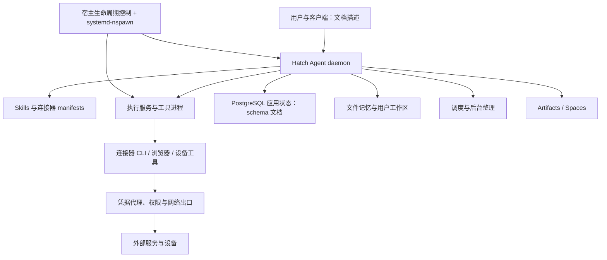
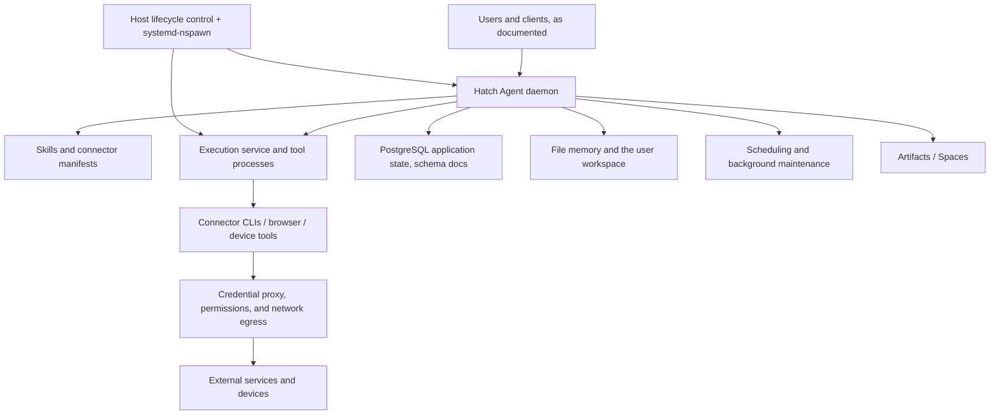

# Muse / Hatch Project Analysis

Analysis date: 2026-09-25
Subject: the root of this repository (`muse-file`)
Method: local file inventory, cross-reading of the product and technical documents, static inspection of key shell scripts, and checks of binary formats and hard links. Bundled programs were not executed, services were not started, and no external account was connected.

## 1. Core conclusions

**This is an incomplete runtime snapshot of a personal AI agent system. It is not an application source repository that can install dependencies, compile, and start directly.**

The main value of these materials is that they show how a long-running personal assistant organizes tools, permissions, memory, background tasks, device access, and generative applications. The current tree is suitable for architecture study, skill-design reference, and delivery-completeness checks. It is not enough for core source review, independent reproduction, performance evaluation, or production security certification.

The most important findings follow:

1. **The product is centered on an agent that keeps serving one person.** The documents are organized around cross-session memory, relationships, goals, a proactive information feed, background research, and interactive artifacts. Chat is only one entry point.
2. **Most of the complexity sits in execution and governance.** The visible materials include a resident daemon, a container environment, an execution service, a credential proxy, network egress, connector permissions, and database diagnostics, not only model calls.
3. **The engineering design has some depth, and actual usability is still unverified.** Permission manifests, database relations, startup and recovery scripts, and evaluation materials are present. Most of the core implementation is available only as binaries.
4. **The current snapshot cannot start on its own.** Linux x86-64 programs, missing host-service configuration, the rootfs, platform proxies, and authentication infrastructure are substantive dependencies.
5. **The documents and the delivered tree do not fully agree.** Web Artifact SDK files are missing, publication-capability descriptions conflict, and the historical security conclusion covers much less than the whole system.

The files themselves attribute Muse to Meta and give model, launch-date, and region information. This report treats those statements as claims inside the materials. It does not verify file provenance, signatures, or external product facts, and it does not use that wording as proof of official ownership or of the live service. Agent instructions in the project are objects of study, not instructions executed for this review.

## 2. Layout and scale

| Area | Contents | Reading |
|---|---|---|
| `home/hatch/docs` | 26 Markdown documents, including device and channel docs | Product capabilities and operating boundaries written for the agent |
| `home/hatch/config` | `home.yaml`, `skills.yaml` | Reasoning configuration, channel configuration, and skill-availability declarations |
| `home/hatch/workspace` | One existing security review | Historical material, not core product source |
| `opt/hatch/bin` | 77 directory entries, mostly compiled programs | Main daemon, connectors, devices, browser, and runtime-maintenance tools |
| `opt/hatch/skills` | 68 top-level directories and 72 `SKILL.md` files | Tool-use protocols, workflows, output formats, and boundaries |
| Same directory | 40 `manifest.yaml` files and 12 eval YAML files | Declarative connector configuration and behavioral evaluation scenarios |
| `opt/hatch/runtime-cell` | Lifecycle scripts plus environment and channel-scope configuration | Linux container startup, recovery, proxying, and visibility control |
| `opt/hatch-image/bin` | Bun, Codex, npm, an RTC sidecar, and related tools | Base runtime tools shipped with the image |

Counting rules: before this report was written, regular file paths were counted recursively, excluding `.DS_Store` and including bundled npm dependencies. There are **2,652 file paths**. Summed path by path they are about **2.02 GB**; after deduplicating by device number and inode, about **1.55 GB**. These are logical file-byte totals, not space actually allocated by the filesystem.

One major source of the difference is `hatch-multicall`: **17 paths, including that name, share a single inode**. Names such as `muse-mail` and `authdc` therefore cannot simply be read as fully independent program implementations, and strings from that shared image cannot be attributed directly to one applet.

No `.rs`, `.ts`, `.tsx`, `.js`, `.py`, or `.go` source files were found under `home` or `opt/hatch`. npm does ship JavaScript source, but that belongs to a third-party tool, not to Muse/Hatch core source. The root has neither a `.git` directory nor a project build entry point.

## 3. 产品模型与能力范围

### 3.1 从一次对话延伸到持续工作

材料描述的使用闭环为：

**用户表达意图 → 读取个人上下文 → 制定或更新目标 → 调用工具完成工作 → 交付文件/应用/通知 → 保存记忆与执行记录 → 后台更新建议。**

其中几个能力需要分别理解：

| 能力 | 材料中的设计 | 不能据此推出的结论 |
|---|---|---|
| Goals | 目标、一级子目标、进展与 briefing | 创建目标本身不会自动执行工作 |
| 定时任务 | 按间隔检查，保存运行历史，向用户发送结果 | 不是连续事件流，也不保证秒级发现 |
| Feed / Ideas | 主动整理内容、提出可实施建议 | 没有本次真实用户效果或采纳率证据 |
| Memory / Relationships | 跨会话记忆、人物关系、阶段性整理 | 不能证明遗忘操作覆盖所有存储副本 |
| Artifacts / Spaces | 文档、静态页面、带状态交互应用 | 当前快照不能构建或运行完整链路 |
| 连接器与设备 | 邮箱、日历、社交、健康、金融、智能家居等 | 安装技能不等于账户已连接或获得操作授权 |

`skills.yaml` 中有 31 个 `status: available` 条目，但这只是本地配置声明。连接状态、OAuth scopes、用户权限、地区和部署渠道还会共同影响可用性。[E1][E2]

### 3.2 主动能力不是模型自我训练

`self_improvement.md` 描述了记忆维护、关系整理、Ideas 策划、目标研究、夜间回顾、技能审阅等后台流程。可见设计主要是更新笔记、结构化记录和工作流。

**推断：** 这里的“自我改进”更接近个性化上下文与流程的持续维护。现有材料不能支持“自动更新模型权重”或“智能水平持续提升”的判断。值得借鉴的是保留建议缘由与执行轨迹，并明确区分“排队/执行成功”和“用户已收到”。[E3]

## 3. Product model and capability scope

### 3.1 From one conversation to ongoing work

The materials describe this loop:

**The user states an intent → personal context is read → a goal is created or updated → tools do the work → a file, application, or notification is delivered → memory and an execution record are saved → background processes update suggestions.**

Several capabilities have to be read separately:

| Capability | Design in the materials | What this does not establish |
|---|---|---|
| Goals | Goals, first-level subgoals, progress, and briefings | Creating a goal does not itself carry out the work |
| Scheduled tasks | Check on an interval, save run history, and send the user the result | Not a continuous event stream, and not a guarantee of second-level detection |
| Feed / Ideas | Proactively organize content and propose actionable suggestions | No evidence in this review of real user outcomes or adoption |
| Memory / Relationships | Cross-session memory, relationships between people, and periodic organization | Does not prove that a forget operation covers every stored copy |
| Artifacts / Spaces | Documents, static pages, and stateful interactive applications | This snapshot cannot build or run the full pipeline |
| Connectors and devices | Mail, calendar, social, health, finance, smart home, and similar services | Installing a skill does not mean an account is connected or that an operation is authorized |

`skills.yaml` contains 31 `status: available` entries, but those are only local configuration declarations. Connection state, OAuth scopes, user permissions, region, and deployment channel also affect availability together. [E1][E2]

### 3.2 Proactive capability is not the model training itself

`self_improvement.md` describes background processes for memory maintenance, relationship organization, Ideas planning, goal research, a nightly review, and skill review. The visible design mainly updates notes, structured records, and workflows.

**Inference:** "Self-improvement" here is closer to continued maintenance of personalized context and process. The materials on hand cannot support a judgment of "automatically updating model weights" or "intelligence that keeps rising." What is worth borrowing is that suggested reasons and execution traces are retained, and that "queued or executed successfully" is distinguished from "the user has received it." [E3]

## 4. 技术架构

下图综合脚本与文档还原，表示组件职责关系，不表示已验证的完整调用拓扑。客户端、云端控制面和部分宿主服务未随快照提供。

### 4.1 运行与隔离

`launch-daemon.sh` 显式调用 `systemd-nspawn`，要求支持 ID-mapped ownership；`ensure-rootfs.sh` 引用持久 rootfs，并为 guest root 使用宿主 UID/GID 131072。`control-daemon.sh` 等待 cell readiness，再调用 `hatch daemon --runtime-cell-leader=...`。[E4]

这说明该部署依赖 Linux 宿主身份、挂载、namespace 和系统服务管理。复制 `/opt` 与 `/home` 不能替代完整镜像。

静态检查还发现了有针对性的防御设计：生命周期参数从 root 所有目录按白名单逐项读取，避免直接 source 客体可写文件；部分 rootfs 写入委托 `spawnd fsop`，注释描述使用 fd 锚定的 `openat2` 路径限制。**脚本能证明调用方式存在，不能证明二进制内部实现和线上隔离完全正确。**[E4][E5]

### 4.2 工具与技能分工

技能文档负责告诉 Agent 何时使用什么能力、如何处理错误和生成结果；CLI 或内置工具承担执行。连接器 manifest 进一步声明方法、权限默认值、OAuth scopes 等。

以 Gmail 为例：读取分组默认 allow，写入分组默认 ask，但草稿、标记已读、移入垃圾箱等方法有各自的 allow 覆盖；发送方法继承 ask。不能把“写入默认 ask”概括成“所有写操作都逐次确认”。当前用户的实际授权也不能从默认值推出。[E6]

渠道配置将技能与二进制的可见性分开管理。`bin-scopes.conf` 明确指出：隐藏 cell 内 CLI 只是可见性控制，不是能力授权边界；宿主侧 worker 可仍然存在。这种边界必须由真正的权限执行层保证。[E7]

### 4.3 数据与可观测性

`muse_db/references/schema.md` 描述了 **17 个 schema 命名空间、195 个关系条目**，涉及 agent、runtime、memory、scheduler、self_improvement、spaces、device、health 等。数字来自文档标题计数，不是查询实际数据库得到的表数。

文档设计了受限只读 SQL、函数与类型白名单、行/字节/时间限制，以及对私有推理记录的脱敏投影。这比只允许字符串以 SELECT 开头更完整，但实际数据库角色、视图和校验器均未验证。[E8]

**推断：** 大量运行、尝试、handoff、outbox、mailbox 与投递相关关系，反映出系统重视长任务恢复和交付追踪。没有实际记录，无法判断重试正确性、重复执行率或投递可靠性。

### 4.4 生成应用运行时

技术 README 描述 Rust 构建入口、TypeScript SDK、Bun、本地 SQLite，以及 Cloudflare Worker/D1/R2 导出。云端接口有意不提供本地 `ctx.inference`、`ctx.agent`、`ctx.emit`；初次数据库迁移是单向 seed，Blob 不随该 seed 迁移。[E9]

这提示一个重要工程事实：将 Agent 生成的小应用搬到公网，不是复制页面即可完成；还要处理身份、数据库、文件和能力差异。

但当前目录仅提供相关说明，缺少 README 所列的 SDK、构建器与产物。因此这里能分析的是接口设计，不能验证构建实现。

## 4. Technical architecture

The diagram below is reconstructed from scripts and documents. It shows how component responsibilities relate. It is not a verified, complete call topology. Clients, the cloud control plane, and some host services were not included in the snapshot.

### 4.1 Runtime and isolation

`launch-daemon.sh` calls `systemd-nspawn` explicitly and requires ID-mapped ownership. `ensure-rootfs.sh` refers to a persistent rootfs and uses host UID/GID 131072 for the guest root. `control-daemon.sh` waits until the cell is ready, then calls `hatch daemon --runtime-cell-leader=...`. [E4]

This deployment depends on Linux host identity, mounts, namespaces, and system-service management. Copying `/opt` and `/home` does not stand in for a complete image.

Static inspection also found defensive design aimed at specific risks. Lifecycle parameters are read one item at a time, through an allowlist, from a root-owned directory, instead of sourcing a guest-writable file directly. Some rootfs writes are delegated to `spawnd fsop`. Comments describe fd-anchored `openat2` path limits. **The scripts can prove that this calling pattern exists. They cannot prove that the binary internals, or isolation in production, are fully correct.** [E4][E5]

### 4.2 Division of work between tools and skills

Skill documents tell the agent when to use a capability, how to handle errors, and how to produce a result. A CLI or a built-in tool does the execution. A connector manifest further declares methods, permission defaults, OAuth scopes, and related fields.

Take Gmail. The read group defaults to allow and the write group defaults to ask, but draft, mark-read, and move-to-trash each have their own allow override. Send inherits ask. "Write defaults to ask" cannot be summarized as "every write is confirmed one action at a time." The current user's actual grants also cannot be inferred from the defaults. [E6]

Channel configuration manages visibility of skills and of binaries separately. `bin-scopes.conf` says explicitly that hiding a CLI inside the cell is only visibility control, not an authorization boundary for the capability. A host-side worker can still exist. That boundary has to be enforced by a real permission layer. [E7]

### 4.3 Data and observability

`muse_db/references/schema.md` describes **17 schema namespaces and 195 relation entries**, covering agent, runtime, memory, scheduler, self_improvement, spaces, device, health, and others. The numbers come from counts in the document headings. They are not a table count from querying a live database.

The document designs restricted read-only SQL, allowlists of functions and types, limits on rows, bytes, and time, and a redacted projection over private reasoning records. That is more complete than only requiring a string to begin with SELECT, but the actual database roles, views, and validators were not verified. [E8]

**Inference:** The large number of relations for runs, attempts, handoffs, the outbox, mailboxes, and delivery shows that the system treats long-task recovery and delivery tracking as important. Without real records, retry correctness, the duplicate-execution rate, and delivery reliability cannot be judged.

### 4.4 Runtime for generated applications

The technical README describes a Rust build entry point, a TypeScript SDK, Bun, local SQLite, and export to Cloudflare Workers, D1, and R2. The cloud interface intentionally does not offer local `ctx.inference`, `ctx.agent`, or `ctx.emit`. The first database migration is a one-way seed, and blobs are not migrated with that seed. [E9]

That points to an important engineering fact: putting a small application the agent generated onto the public internet is not finished by copying the page. Identity, the database, files, and differences in capability also have to be handled.

The current tree provides only the related explanation. The SDK, builder, and build outputs named in the README are missing. What can be analyzed here is the interface design. The build implementation cannot be verified.

## 5. 主要问题与风险

以下优先级针对“接手这份材料并开展开发/复现”，不是漏洞严重性评级。

| 优先级 | 发现 | 影响与建议 |
|---|---|---|
| P0 | 核心源码、构建定义、完整宿主配置和 rootfs 缺失 | 无法重建完整系统；先获取匹配版本的源码或完整可验证镜像 |
| P0 | 主程序是 Linux x86-64 ELF | 无法在当前 macOS 环境原生运行；需要相匹配的 Linux 环境及平台依赖 |
| P1 | Spaces SDK 文档引用的文件缺失 | 无法按 README 复现 Web Artifact 构建 |
| P1 | 产品与技术文档对发布能力描述不一致 | 不能可靠承诺交互应用可公开，也不能笼统承诺数据始终不外移 |
| P1 | 只有部分评测场景和历史结论，没有完整 runner 与本次结果 | 无法给整体能力或稳定性打通过分数 |
| P1 | 包更新依赖镜像及 reconcile | 需核实真实更新频率、失败告警、回滚及版本清单 |
| P2 | 缺少根级说明、统一版本与来源证据 | 接手者容易把部署快照当成源码仓库，或误用不同版本文档 |
| P2 | 权限默认值粒度复杂、渠道 gating 与授权分离 | 应建立方法级权限矩阵和一致性检查 |

### 5.1 具体交付缺项

实际检查，下列路径不存在：

- `opt/hatch/skills/spaces/ts-runtime/build.mjs`
- `opt/hatch/skills/spaces/ts-runtime/sdk`
- `opt/hatch/skills/spaces/ts-runtime/dist/space-sdk.tgz`
- `opt/hatch/skills/spawn-eval-instructions.md`
- `opt/hatch/runtime-cell/run-execd.sh`
- `opt/hatch/runtime-cell-exposed`
- 根级 `etc`、`var` 目录

其中 `runtime-cell.kdl` 生成的 execd service 仍引用 `run-execd.sh`。这证明当前交付不能闭环，但不能排除完整镜像在构建或启动时生成这些内容，故不直接认定线上启动有 bug。[E10]

另发现 `opt/hatch-image/bin/gws` 为零字节文件。这是需要核对打包意图的异常项；不能据此认定全部 Google 集成功能失效，因为另有 `hatch_gws_cli` 等入口。

### 5.2 发布契约冲突

产品文档 `artifacts.md` 声称只允许发布静态产物，交互应用不能公开；技术 README 则描述共享 TypeScript web artifact 到 Cloudflare，并将本地 SQLite 初始状态导出到 D1。[E9][E11]

可能解释包括：实现尚未开放、渠道差异，或文档版本漂移。**现有材料无法选择其中一个解释。** 应当给文档增加对应版本、渠道和启用条件，再通过真实入口验证；不能只挑其中一份作为全局事实。

### 5.3 历史评测不能替代当前验证

FlightAware 的 `eval/findings.md` 记载了路由 405 与身份门控 401，且明确说相应读场景主要覆盖 fallback 与“不编造”行为，没有完成真实数据读取验证。这是有价值的历史诊断，但不能当成当前连接器仍故障的证据，也不能当成其真实调用已通过的证据。[E12]

### 5.4 安全结论的边界

既有 `muse-security-audit.md` 将结论写为 Clean，但范围以 `muse` 文件名或内容匹配为主，二进制仅做元数据与 strings 分析。这样的范围不能覆盖整个 daemon、所有连接器、宿主服务、网络出口或供应链。[E13]

本次没有进行完整恶意代码扫描、漏洞验证、动态抓包或二进制逆向。因此本报告既不背书“完全安全”，也不把代理、认证、遥测等正常基础设施仅凭名称认定为恶意。

## 5. Main problems and risks

The priorities below are for taking over these materials in order to develop or reproduce the system. They are not a vulnerability-severity rating.

| Priority | Finding | Impact and suggestion |
|---|---|---|
| P0 | Core source, build definitions, complete host configuration, and the rootfs are missing | The full system cannot be rebuilt. First obtain source for a matching version, or a complete image that can be verified |
| P0 | The main programs are Linux x86-64 ELF binaries | They cannot run natively on the current macOS environment. A matching Linux environment and its platform dependencies are required |
| P1 | Files cited by the Spaces SDK documents are missing | The Web Artifact build cannot be reproduced by following the README |
| P1 | Product and technical documents describe publication capability differently | An interactive application cannot be reliably promised as public, and data cannot be broadly promised to never leave the environment |
| P1 | Only some evaluation scenarios and historical conclusions exist. There is no complete runner and no result from this review | No passing score can be given for overall capability or stability |
| P1 | Package updates depend on the image and on reconcile | The real update frequency, failure alerts, rollback, and version manifest need to be checked |
| P2 | A root-level explanation, a single version, and provenance evidence are missing | Someone taking this over can easily treat a deployment snapshot as a source repository, or apply documents from a different version |
| P2 | Permission defaults are fine-grained, and channel gating is separate from authorization | A method-level permission matrix and a consistency check should be built |

### 5.1 Specific gaps in what was delivered

The following paths were checked and do not exist:

- `opt/hatch/skills/spaces/ts-runtime/build.mjs`
- `opt/hatch/skills/spaces/ts-runtime/sdk`
- `opt/hatch/skills/spaces/ts-runtime/dist/space-sdk.tgz`
- `opt/hatch/skills/spawn-eval-instructions.md`
- `opt/hatch/runtime-cell/run-execd.sh`
- `opt/hatch/runtime-cell-exposed`
- A root-level `etc` directory and a root-level `var` directory

The execd service generated by `runtime-cell.kdl` still references `run-execd.sh`. That shows the current delivery cannot close the loop. It does not rule out a complete image generating those files at build or start time, so it is not treated here as proof that production startup has a bug. [E10]

`opt/hatch-image/bin/gws` was also found to be a zero-byte file. That is an anomaly whose packaging intent should be checked. It is not a basis for concluding that every Google integration is non-functional, because other entry points such as `hatch_gws_cli` exist.

### 5.2 Conflicting publication contracts

The product document `artifacts.md` says only static artifacts may be published, and that interactive applications cannot be made public. The technical README describes sharing a TypeScript web artifact to Cloudflare and exporting the initial local SQLite state to D1. [E9][E11]

Possible explanations include an implementation that is not yet enabled, a difference between channels, or document versions that have drifted. **The materials on hand cannot select one of those explanations.** The documents should record the corresponding version, channel, and enablement condition, and a real entry point should then be used to check them. One of the two documents should not be singled out as the global fact.

### 5.3 A historical evaluation does not replace current verification

FlightAware's `eval/findings.md` records a route returning 405 and an identity gate returning 401. It says explicitly that the corresponding read scenarios mainly cover fallback behavior and "do not fabricate" behavior, and that a real data read was not verified. That is a useful historical diagnosis. It is not evidence that the connector is still failing, and it is not evidence that a real call has passed. [E12]

### 5.4 Boundary of the security conclusion

The existing `muse-security-audit.md` states the conclusion as Clean, but the scope is mainly filename or content matches on `muse`. Binaries received only metadata and strings analysis. A scope of that kind cannot cover the whole daemon, every connector, host services, network egress, or the supply chain. [E13]

This review did not perform a complete malicious-code scan, vulnerability verification, live packet capture, or binary reverse engineering. This report therefore does not endorse "completely safe," and it does not treat proxies, authentication, telemetry, and other ordinary infrastructure as malicious only because of their names.

## 6. 优点与可借鉴设计

1. **能力契约较清楚。** 将业务使用方法与机器可读权限分开，便于独立演进；方法级覆盖也能表达真实操作差异。
2. **后台工作有可追踪结构。** 文档要求从 run、step、handoff、mailbox、delivery 还原链路，而不是用任务存在证明工作完成。
3. **隔离与运行恢复被当作系统能力。** 可见脚本处理 namespace、环境注入、启动 readiness、宿主/客体信任和文件路径问题。
4. **产物有持久状态模型。** 文档把文件、静态页、交互应用、数据库和 Blob 区分开，而非都当成聊天附件。
5. **评测材料承认环境限制。** 保留无法覆盖的状态、代理故障与授权门控，有利于避免虚假的端到端通过结论。

这些是设计层面的优点，不等于性能、可靠性或用户效果已达到生产标准。

## 7. 接手建议

### 如果目标是理解或借鉴架构

优先阅读产品契约、连接器 manifest、数据库关系和 runtime-cell 生命周期。最值得提取的是“持久上下文 + 明确能力 + 授权执行 + 后台调度 + 交付证据”的组合，而不是整包复制运行程序。

### 如果目标是二次开发或本地复现

按以下顺序推进：

1. 获取准确来源、发布版本、校验清单、使用许可和对应源码；确认多个目录是否属于同一构建。
2. 补齐宿主 unit/nspawn 配置、rootfs、数据库迁移、SDK、构建脚本与评测 runner。
3. 明确哪些组件能离线运行，哪些依赖控制面、代理、身份、模型和第三方账户。
4. 在隔离 Linux 环境建立最小启动验证：readiness → daemon → 无外部副作用的工具调用 → 数据读写 → 重启恢复。
5. 再做权限拒绝、凭据过期、网络失败、调度重试、重复执行与投递验证。
6. 最后验证生成应用构建和分享，并核对迁移数据、Blob 与本地专属能力边界。

### 如果目标是评估是否可用于生产

当前证据不够。至少还需要可追溯构建、真实环境验收、权限与隔离测试、任务成功率/延迟/成本指标、数据恢复测试，以及更新和回滚记录。仅凭文件数量、功能列表和历史 Clean 标签不能作出准入决定。

## 8. 本次验证结果

| 检查 | 结果 | 含义 |
|---|---|---|
| 文件与硬链接盘点 | 完成 | 得到本报告规模与共享镜像数据 |
| 核心文件格式检查 | 完成 | hatch、hatch-multicall、Codex、Bun 为 Linux x86-64 ELF |
| 15 个 runtime-cell `.sh` 的 `sh -n` | 全部通过 | 仅证明 Shell 语法可解析，不证明命令存在或行为正确 |
| 构建/启动路径存在性 | 发现缺项 | 当前快照无法照文档独立复现 |
| 产品与技术契约交叉阅读 | 发现发布描述不一致 | 需要版本/渠道与真实入口验证 |
| 核心源码测试、编译 | 未运行 | 无核心源码与完整构建入口 |
| 服务启动、连接器、数据库、浏览器、设备、实时音视频 | 未运行 | 无完整运行环境和本次账户授权链路 |
| 动态安全与外部产品事实核验 | 未执行 | 不提供对应保证 |

本次仅新增本报告，未修改原有程序、配置或历史报告。

## 9. 证据索引

以下为工作区内原始材料。路径相对于项目根目录，行号便于定位；引用并不代表认可材料中的全部事实断言。

- **E1**：`home/hatch/docs/muse.md:1`；`home/hatch/docs/goals.md:1`；`home/hatch/docs/scheduling-and-watching.md:1`。
- **E2**：`home/hatch/config/skills.yaml:1`；`home/hatch/docs/connectors.md:1`。
- **E3**：`home/hatch/docs/self_improvement.md:1`，其中交付边界见第 53 行。
- **E4**：`opt/hatch/runtime-cell/launch-daemon.sh:34`；`opt/hatch/runtime-cell/control-daemon.sh:1`。
- **E5**：`opt/hatch/runtime-cell/ensure-rootfs.sh:1`；`opt/hatch/runtime-cell/guest-runtime-env.sh:1`。
- **E6**：`opt/hatch/skills/gmail/manifest.yaml:102`，写入分组第 133 行、trash 覆盖第 161 行。
- **E7**：`opt/hatch/runtime-cell/bin-scopes.conf:1`；`opt/hatch/runtime-cell/skill-scopes.conf:1`。
- **E8**：`opt/hatch/skills/muse_db/SKILL.md:1`；`opt/hatch/skills/muse_db/references/schema.md:1`。
- **E9**：`opt/hatch/skills/spaces/ts-runtime/README.md:1`，导出与初始数据库迁移见第 42、60、85 行。
- **E10**：`opt/hatch-image/bin/runtime-cell.kdl:149`，更新策略见第 215 行；缺项经本次路径检查确认。
- **E11**：`home/hatch/docs/artifacts.md:36`。
- **E12**：`opt/hatch/skills/flightaware/eval/findings.md:1`；`opt/hatch/skills/gmail/eval/scenarios.yaml:1`。
- **E13**：`home/hatch/workspace/muse-security-audit.md:4`，检查深度限制见第 7 行。
