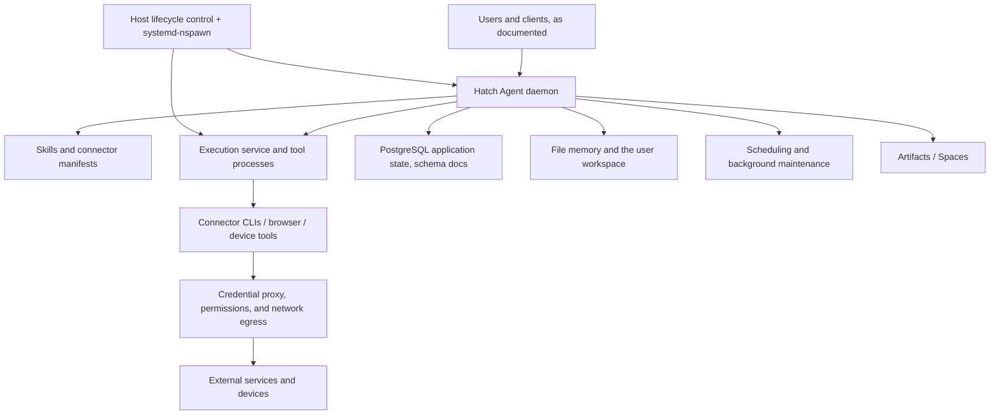

# Muse / Hatch Project Analysis

Analysis date: 2026-09-25
Subject: the root of this repository (`muse-file`)
Method: local file inventory, cross-reading of the product and technical documents, static inspection of key shell scripts, and checks of binary formats and hard links. Bundled programs were not executed, services were not started, and no external account was connected.

## 1. Core conclusions

**This is an incomplete runtime snapshot of a personal AI agent system. It is not an application source repository that can install dependencies, compile, and start directly.**

The main value of these materials is that they show how a long-running personal assistant organizes tools, permissions, memory, background tasks, device access, and generative applications. The current tree is suitable for architecture study, skill-design reference, and delivery-completeness checks. It is not enough for core source review, independent reproduction, performance evaluation, or production security certification.

The most important findings follow:

1. **The product is centered on an agent that keeps serving one person.** The documents are organized around cross-session memory, relationships, goals, a proactive information feed, background research, and interactive artifacts. Chat is only one entry point.
2. **Most of the complexity sits in execution and governance.** The visible materials include a resident daemon, a container environment, an execution service, a credential proxy, network egress, connector permissions, and database diagnostics, not only model calls.
3. **The engineering design has some depth, and actual usability is still unverified.** Permission manifests, database relations, startup and recovery scripts, and evaluation materials are present. Most of the core implementation is available only as binaries.
4. **The current snapshot cannot start on its own.** Linux x86-64 programs, missing host-service configuration, the rootfs, platform proxies, and authentication infrastructure are substantive dependencies.
5. **The documents and the delivered tree do not fully agree.** Web Artifact SDK files are missing, publication-capability descriptions conflict, and the historical security conclusion covers much less than the whole system.

The files themselves attribute Muse to Meta and give model, launch-date, and region information. This report treats those statements as claims inside the materials. It does not verify file provenance, signatures, or external product facts, and it does not use that wording as proof of official ownership or of the live service. Agent instructions in the project are objects of study, not instructions executed for this review.

## 2. Layout and scale

| Area | Contents | Reading |
|---|---|---|
| `home/hatch/docs` | 26 Markdown documents, including device and channel docs | Product capabilities and operating boundaries written for the agent |
| `home/hatch/config` | `home.yaml`, `skills.yaml` | Reasoning configuration, channel configuration, and skill-availability declarations |
| `home/hatch/workspace` | One existing security review | Historical material, not core product source |
| `opt/hatch/bin` | 77 directory entries, mostly compiled programs | Main daemon, connectors, devices, browser, and runtime-maintenance tools |
| `opt/hatch/skills` | 68 top-level directories and 72 `SKILL.md` files | Tool-use protocols, workflows, output formats, and boundaries |
| Same directory | 40 `manifest.yaml` files and 12 eval YAML files | Declarative connector configuration and behavioral evaluation scenarios |
| `opt/hatch/runtime-cell` | Lifecycle scripts plus environment and channel-scope configuration | Linux container startup, recovery, proxying, and visibility control |
| `opt/hatch-image/bin` | Bun, Codex, npm, an RTC sidecar, and related tools | Base runtime tools shipped with the image |

Counting rules: before this report was written, regular file paths were counted recursively, excluding `.DS_Store` and including bundled npm dependencies. There are **2,652 file paths**. Summed path by path they are about **2.02 GB**; after deduplicating by device number and inode, about **1.55 GB**. These are logical file-byte totals, not space actually allocated by the filesystem.

One major source of the difference is `hatch-multicall`: **17 paths, including that name, share a single inode**. Names such as `muse-mail` and `authdc` therefore cannot simply be read as fully independent program implementations, and strings from that shared image cannot be attributed directly to one applet.

No `.rs`, `.ts`, `.tsx`, `.js`, `.py`, or `.go` source files were found under `home` or `opt/hatch`. npm does ship JavaScript source, but that belongs to a third-party tool, not to Muse/Hatch core source. The root has neither a `.git` directory nor a project build entry point.

## 3. Product model and capability scope

### 3.1 From one conversation to ongoing work

The materials describe this loop:

**The user states an intent → personal context is read → a goal is created or updated → tools do the work → a file, application, or notification is delivered → memory and an execution record are saved → background processes update suggestions.**

Several capabilities have to be understood separately:

| Capability | Design in the materials | What this does not establish |
|---|---|---|
| Goals | Goals, first-level subgoals, progress, and briefings | Creating a goal does not itself carry out the work |
| Scheduled tasks | Check on an interval, save run history, and send the user the result | Not a continuous event stream, and not a guarantee that a change is noticed within a second |
| Feed / Ideas | Proactively organize content and propose actionable suggestions | No evidence in this review of real user outcomes or adoption |
| Memory / Relationships | Cross-session memory, relationships between people, and periodic organization | Does not prove that a forget operation covers every stored copy |
| Artifacts / Spaces | Documents, static pages, and stateful interactive applications | This snapshot cannot build or run the full pipeline |
| Connectors and devices | Mail, calendar, social, health, finance, smart home, and similar services | Installing a skill does not mean an account is connected or that an operation is authorized |

`skills.yaml` contains 31 `status: available` entries, but those are only local configuration declarations. Connection state, OAuth scopes, user permissions, region, and deployment channel also affect availability together. [E1][E2]

### 3.2 Proactive capability is not model self-training

`self_improvement.md` describes background processes for memory maintenance, relationship organization, Ideas planning, goal research, a nightly review, and skill review. The visible design mainly updates notes, structured records, and workflows.

**Inference:** "Self-improvement" here is closer to continued maintenance of personalized context and process. The materials on hand cannot support a judgment of "automatically updating model weights" or "intelligence that keeps rising." What is worth borrowing is that the reason for a suggestion and the execution trace are kept, and that "queued or executed successfully" is distinguished from "the user has received it." [E3]

## 4. Technical architecture

The diagram below is reconstructed from scripts and documents. It shows how component responsibilities relate. It is not a verified, complete call topology. Clients, the cloud control plane, and some host services were not included in the snapshot.

### 4.1 Runtime and isolation

`launch-daemon.sh` calls `systemd-nspawn` explicitly and requires ID-mapped ownership. `ensure-rootfs.sh` refers to a persistent rootfs and uses host UID/GID 131072 for the guest root. `control-daemon.sh` waits until the cell is ready, then calls `hatch daemon --runtime-cell-leader=...`. [E4]

This deployment depends on Linux host identity, mounts, namespaces, and system-service management. Copying `/opt` and `/home` does not stand in for a complete image.

Static inspection also found defensive design aimed at specific risks. Lifecycle parameters are read one item at a time, through an allowlist, from a root-owned directory, instead of sourcing a guest-writable file directly. Some rootfs writes are delegated to `spawnd fsop`. Comments describe fd-anchored `openat2` path limits. **The scripts can prove that this calling pattern exists. They cannot prove that the binary internals, or isolation in production, are fully correct.** [E4][E5]

### 4.2 Division of work between tools and skills

Skill documents tell the agent when to use a capability, how to handle errors, and how to produce a result. A CLI or a built-in tool does the execution. A connector manifest further declares methods, permission defaults, OAuth scopes, and related fields.

Take Gmail. The read group defaults to allow and the write group defaults to ask, but draft, mark-read, and move-to-trash each have their own allow override. Send inherits ask. "Write defaults to ask" cannot be summarized as "every write is confirmed one action at a time." The current user's actual grants also cannot be inferred from the defaults. [E6]

Channel configuration manages visibility of skills and of binaries separately. `bin-scopes.conf` says explicitly that hiding a CLI inside the cell is only visibility control, not an authorization boundary for the capability. A host-side worker can still exist. That boundary has to be enforced by a real permission layer. [E7]

### 4.3 Data and observability

`muse_db/references/schema.md` describes **17 schema namespaces and 195 relation entries**, covering agent, runtime, memory, scheduler, self_improvement, spaces, device, health, and others. The numbers come from counts in the document headings. They are not a table count from querying a live database.

The document designs restricted read-only SQL, allowlists of functions and types, limits on rows, bytes, and time, and a redacted projection over private reasoning records. That is more complete than only requiring a string to begin with SELECT, but the actual database roles, views, and validators were not verified. [E8]

**Inference:** The large number of relations for runs, attempts, handoffs, the outbox, mailboxes, and delivery shows that the system treats long-task recovery and delivery tracking as important. Without real records, retry correctness, the duplicate-execution rate, and delivery reliability cannot be judged.

### 4.4 Runtime for generated applications

The technical README describes a Rust build entry point, a TypeScript SDK, Bun, local SQLite, and export to Cloudflare Workers, D1, and R2. The cloud interface intentionally does not offer local `ctx.inference`, `ctx.agent`, or `ctx.emit`. The first database migration is a one-way seed, and blobs are not migrated with that seed. [E9]

That points to an important engineering fact: putting a small application the agent generated onto the public internet is not finished by copying the page. Identity, the database, files, and differences in capability also have to be handled.

The current tree provides only the related explanation. The SDK, builder, and build outputs named in the README are missing. What can be analyzed here is the interface design. The build implementation cannot be verified.

## 5. Main problems and risks

The priorities below are for taking over these materials in order to develop or reproduce the system. They are not a vulnerability-severity rating.

| Priority | Finding | Impact and suggestion |
|---|---|---|
| P0 | Core source, build definitions, complete host configuration, and the rootfs are missing | The full system cannot be rebuilt. First obtain source for a matching version, or a complete image that can be verified |
| P0 | The main programs are Linux x86-64 ELF binaries | They cannot run natively on the current macOS environment. A matching Linux environment and its platform dependencies are required |
| P1 | Files cited by the Spaces SDK documents are missing | The Web Artifact build cannot be reproduced by following the README |
| P1 | Product and technical documents describe publication capability differently | An interactive application cannot be reliably promised as public, and data cannot be broadly promised to never leave the environment |
| P1 | Only some evaluation scenarios and historical conclusions exist. There is no complete runner and no result from this review | No passing score can be given for overall capability or stability |
| P1 | Package updates depend on the image and on reconcile | The real update frequency, failure alerts, rollback, and version manifest need to be checked |
| P2 | A root-level explanation, a single version, and provenance evidence are missing | Someone taking this over can easily treat a deployment snapshot as a source repository, or apply documents from a different version |
| P2 | Permission defaults are fine-grained, and channel gating is separate from authorization | A method-level permission matrix and a consistency check should be built |

### 5.1 Specific gaps in what was delivered

The following paths were checked and do not exist:

- `opt/hatch/skills/spaces/ts-runtime/build.mjs`
- `opt/hatch/skills/spaces/ts-runtime/sdk`
- `opt/hatch/skills/spaces/ts-runtime/dist/space-sdk.tgz`
- `opt/hatch/skills/spawn-eval-instructions.md`
- `opt/hatch/runtime-cell/run-execd.sh`
- `opt/hatch/runtime-cell-exposed`
- A root-level `etc` directory and a root-level `var` directory

The execd service generated by `runtime-cell.kdl` still references `run-execd.sh`. That shows the current delivery cannot close the loop. It does not rule out a complete image generating those files at build or start time, so it is not treated here as proof that production startup has a bug. [E10]

`opt/hatch-image/bin/gws` was also found to be a zero-byte file. That is an anomaly whose packaging intent should be checked. It is not a basis for concluding that every Google integration is non-functional, because other entry points such as `hatch_gws_cli` exist.

### 5.2 Conflicting publication contracts

The product document `artifacts.md` says only static artifacts may be published, and that interactive applications cannot be made public. The technical README describes sharing a TypeScript web artifact to Cloudflare and exporting the initial local SQLite state to D1. [E9][E11]

Possible explanations include an implementation that is not yet enabled, a difference between channels, or document versions that have drifted. **The materials on hand cannot select one of those explanations.** The documents should record the corresponding version, channel, and enablement condition, and a real entry point should then be used to check them. One of the two documents should not be singled out as the global fact.

### 5.3 A historical evaluation does not replace current verification

FlightAware's `eval/findings.md` records a route returning 405 and an identity gate returning 401. It says explicitly that the corresponding read scenarios mainly cover fallback behavior and "do not fabricate" behavior, and that a real data read was not verified. That is a useful historical diagnosis. It is not evidence that the connector is still failing, and it is not evidence that a real call has passed. [E12]

### 5.4 Boundary of the security conclusion

The existing `muse-security-audit.md` states the conclusion as Clean, but the scope is mainly filename or content matches on `muse`. Binaries received only metadata and strings analysis. A scope of that kind cannot cover the whole daemon, every connector, host services, network egress, or the supply chain. [E13]

This review did not perform a complete malicious-code scan, vulnerability verification, live packet capture, or binary reverse engineering. This report therefore does not endorse "completely safe," and it does not treat proxies, authentication, telemetry, and other ordinary infrastructure as malicious only because of their names.

## 6. Strengths and designs worth borrowing

1. **Capability contracts are relatively clear.** How a capability is used is separated from machine-readable permissions, so the two can evolve independently. Method-level overrides can also express real differences between operations.
2. **Background work has a structure that can be traced.** The documents require a chain reconstructed from run, step, handoff, mailbox, and delivery, rather than treating the existence of a task as proof that the work is finished.
3. **Isolation and runtime recovery are treated as system capabilities.** The visible scripts deal with namespaces, environment injection, startup readiness, host and guest trust, and file-path problems.
4. **Artifacts have a model of persistent state.** The documents separate files, static pages, interactive applications, databases, and blobs, instead of treating all of them as chat attachments.
5. **The evaluation materials admit limits of the environment.** States that could not be covered, proxy failures, and authorization gates are kept, which helps avoid a false end-to-end pass.

These are strengths at the level of design. They do not mean performance, reliability, or user outcomes already meet a production standard.

## 7. Suggestions for taking this over

### If the goal is to understand the architecture or borrow from it

Read the product contract, connector manifests, database relations, and the runtime-cell lifecycle first. What is most worth extracting is the combination of persistent context, explicit capabilities, authorized execution, background scheduling, and delivery evidence, rather than copying the whole bundle of programs and running it.

### If the goal is further development or local reproduction

Proceed in this order:

1. Obtain an accurate source, a release version, a checksum list, the terms of use, and the matching source code. Confirm whether the several directories belong to the same build.
2. Supply the missing host unit and nspawn configuration, rootfs, database migrations, SDK, build scripts, and evaluation runner.
3. State which components can run offline and which depend on a control plane, proxies, identity, models, and third-party accounts.
4. In an isolated Linux environment, establish a minimal startup check: readiness, then the daemon, then a tool call with no external side effect, then reading and writing data, then recovery after restart.
5. Then test permission denial, credential expiry, network failure, schedule retry, duplicate execution, and delivery.
6. Finally verify build and sharing of generated applications, and check migrated data, blobs, and the boundary around capabilities that exist only locally.

### If the goal is to judge whether this can be used in production

The current evidence is not enough. At a minimum, a traceable build, acceptance in a real environment, permission and isolation tests, metrics for task success rate, latency, and cost, a data-recovery test, and records of updates and rollbacks are still required. A file count, a feature list, and a historical Clean label are not enough to make an admission decision.

## 8. Results of this review

| Check | Result | Meaning |
|---|---|---|
| File and hard-link inventory | Completed | Produced the scale and shared-image figures in this report |
| Core file format checks | Completed | hatch, hatch-multicall, Codex, and Bun are Linux x86-64 ELF binaries |
| `sh -n` on 15 runtime-cell `.sh` files | All passed | Proves only that the shell syntax can be parsed, not that the commands exist or behave correctly |
| Presence of build and startup paths | Gaps found | This snapshot cannot be reproduced on its own by following the documents |
| Cross-reading of the product and technical contracts | Publication descriptions disagree | Version, channel, and a real entry point still need to be checked |
| Core source tests and compilation | Not run | There is no core source and no complete build entry point |
| Service startup, connectors, database, browser, devices, and realtime audio and video | Not run | There is no complete runtime environment and no account-authorization path for this review |
| Dynamic security testing and checks against external product facts | Not performed | No corresponding assurance is offered |

This review added only this report. Existing programs, configuration, and the historical report were not modified.

## 9. Evidence index

The items below are original materials in the workspace. Paths are relative to the project root, and line numbers are there to locate the text. A citation does not mean every factual claim in the cited material is endorsed.

- **E1**: `home/hatch/docs/muse.md:1`; `home/hatch/docs/goals.md:1`; `home/hatch/docs/scheduling-and-watching.md:1`.
- **E2**: `home/hatch/config/skills.yaml:1`; `home/hatch/docs/connectors.md:1`.
- **E3**: `home/hatch/docs/self_improvement.md:1`. The delivery boundary is at line 53.
- **E4**: `opt/hatch/runtime-cell/launch-daemon.sh:34`; `opt/hatch/runtime-cell/control-daemon.sh:1`.
- **E5**: `opt/hatch/runtime-cell/ensure-rootfs.sh:1`; `opt/hatch/runtime-cell/guest-runtime-env.sh:1`.
- **E6**: `opt/hatch/skills/gmail/manifest.yaml:102`. The write group is at line 133, and the trash override is at line 161.
- **E7**: `opt/hatch/runtime-cell/bin-scopes.conf:1`; `opt/hatch/runtime-cell/skill-scopes.conf:1`.
- **E8**: `opt/hatch/skills/muse_db/SKILL.md:1`; `opt/hatch/skills/muse_db/references/schema.md:1`.
- **E9**: `opt/hatch/skills/spaces/ts-runtime/README.md:1`. Export and the initial database migration are at lines 42, 60, and 85.
- **E10**: `opt/hatch-image/bin/runtime-cell.kdl:149`. The update policy is at line 215. The missing paths were confirmed by path checks in this review.
- **E11**: `home/hatch/docs/artifacts.md:36`.
- **E12**: `opt/hatch/skills/flightaware/eval/findings.md:1`; `opt/hatch/skills/gmail/eval/scenarios.yaml:1`.
- **E13**: `home/hatch/workspace/muse-security-audit.md:4`. The limit on inspection depth is at line 7.
