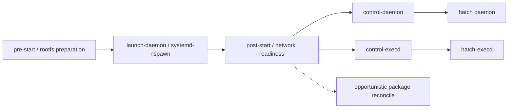

# [🚀 Watch my Bilibili videos](https://space.bilibili.com/3493277319825652)

# MuseAI-Skills

### 🔥🔥🔥🔥 If you have not registered for Muse yet, use my invite code to sign up and get 1 billion tokens! Invite code: ZLSD3V


Skill documentation and a Muse / Hatch runtime snapshot associated with [muse.ai (Muse AI)](https://muse.ai).

[English](README.en.md) · [Technical analysis](PROJECT_ANALYSIS.md) · [File checksums](SHA256SUMS)

**Navigate:** [Skills](#skills) · [Files](#files) · [Architecture](#architecture) · [Download](#download)

**Muse AI in this repository refers to [muse.ai](https://muse.ai)**, the website identified in the bundled [product overview](home/hatch/docs/muse.md). This repository archives a partial filesystem snapshot of that Muse / Hatch personal AI agent environment. It contains product documentation, skill definitions, connector permission manifests, Linux runtime scripts, and bundled executables and dependencies for inspection and technical analysis.

**This is neither a complete source repository nor a one-command deployment package.** Most core programs are Linux x86-64 ELF binaries. Their source code, complete host configuration, root filesystem, and some runtime resources are absent. The supplied materials use the names Muse, Hatch, and Jarvis; this archive does not represent an official release or endorsement, and its provenance and product claims have not been independently verified.

<a id="skills"></a>

## Skills: the main reading collection

The skill texts are a particularly useful part of this snapshot for studying agent workflow design: they describe **when to trigger, how to route tasks, which tools to use, how to handle authorization and failure, and how to verify deliverables**. They can be inspected without downloading the large executables.

There are **72 `SKILL.md` paths: 68 distinct skill files plus 4 symlink aliases**. The tables below cover all 68 distinct files; the aliases are listed separately. Names are directory paths, which can differ from frontmatter names. “Bundled skills” describes their location in the snapshot, not independently authenticated official provenance or a verified open-source release.

### Suggested reading path

These selections emphasize workflow design that is useful to examine, not proven execution quality or drop-in compatibility.

| Skill | What to study |
|---|---|
| [wide-research](opt/hatch/skills/wide-research/SKILL.md) | Coordinator/worker boundaries, consistent output contracts, and failure coverage. |
| [skill-creator](opt/hatch/skills/skill-creator/SKILL.md) | Clear triggers, concise operational files, and on-demand references. |
| [artifacts/testing](opt/hatch/skills/artifacts/testing/SKILL.md) | Separate successful generation from usable, visually verified deliverables. |
| [goals](opt/hatch/skills/goals/SKILL.md) | Separate initial goal intake from ongoing support by life domain. |
| [forget](opt/hatch/skills/forget/SKILL.md) | Account for copies, derived state, and background work that can recreate information. |
| [travel-planning](opt/hatch/skills/travel-planning/SKILL.md) | Route itinerary research separately from live availability and transactions. |
| [magic-moment](opt/hatch/skills/magic-moment/SKILL.md) | Organize facts, narrative, visuals, timelines, and pre-render review. |
| [gmail](opt/hatch/skills/gmail/SKILL.md) | Read instructions together with method-level permissions and evaluation scenarios. |

### Agent workflows and memory (6)

| Skill | Documented purpose | Supporting files |
|---|---|---|
| [wide-research](opt/hatch/skills/wide-research/SKILL.md) | Research many independent inputs with a shared output schema, coverage counts, and failure reporting. | — |
| [goals](opt/hatch/skills/goals/SKILL.md) | Create goals by life domain, record commitments, and follow progress. | [Creation](opt/hatch/skills/goals/creation) · [Guides](opt/hatch/skills/goals/guides) |
| [skill-creator](opt/hatch/skills/skill-creator/SKILL.md) | Author skill triggers, resource layout, tooling/auth sections, and validation checks. | [References](opt/hatch/skills/skill-creator/references) |
| [self-awareness](opt/hatch/skills/self-awareness/SKILL.md) | Ground answers about agent capabilities, memory, and past work in observed state. | [References](opt/hatch/skills/self-awareness/references) |
| [forget](opt/hatch/skills/forget/SKILL.md) | Plan, confirm, and verify forgetting across memory and derived content. | [References](opt/hatch/skills/forget/references) |
| [muse_db](opt/hatch/skills/muse_db/SKILL.md) | Use bounded read-only database queries to trace execution and delivery records. | [References](opt/hatch/skills/muse_db/references) |

### Documents, spreadsheets, and artifact verification (6)

| Skill | Documented purpose | Supporting files |
|---|---|---|
| [artifacts/document](opt/hatch/skills/artifacts/document/SKILL.md) | Create and edit Word documents/templates, OOXML, tracked changes, and rendered output. | [References](opt/hatch/skills/artifacts/document/references) |
| [artifacts/markdown](opt/hatch/skills/artifacts/markdown/SKILL.md) | Produce Markdown files, READMEs, notes, and read-back verification. | — |
| [artifacts/pdf](opt/hatch/skills/artifacts/pdf/SKILL.md) | Author and manipulate PDFs, fill forms, and validate page geometry. | [References](opt/hatch/skills/artifacts/pdf/references) |
| [artifacts/presentation](opt/hatch/skills/artifacts/presentation/SKILL.md) | Build slides from per-slide HTML, theme plans, assembly, and PPTX export. | [References](opt/hatch/skills/artifacts/presentation/references) |
| [artifacts/spreadsheet](opt/hatch/skills/artifacts/spreadsheet/SKILL.md) | Create and clean spreadsheets, recalculate formulas, and validate workbooks. | [References](opt/hatch/skills/artifacts/spreadsheet/references) |
| [artifacts/testing](opt/hatch/skills/artifacts/testing/SKILL.md) | Apply per-format checks, fresh rendering, visual inspection, and placeholder scans. | — |

### Travel, local discovery, and booking (7)

| Skill | Documented purpose | Supporting files |
|---|---|---|
| [travel-planning](opt/hatch/skills/travel-planning/SKILL.md) | Plan itineraries, feasibility, entry/transit requirements, and ground logistics. | [Eval](opt/hatch/skills/travel-planning/eval) · [References](opt/hatch/skills/travel-planning/references) |
| [booking](opt/hatch/skills/booking/SKILL.md) | Route live availability and transactions for flights, hotels, restaurants, and tickets. | [Eval](opt/hatch/skills/booking/eval) · [References](opt/hatch/skills/booking/references) |
| [places-search](opt/hatch/skills/places-search/SKILL.md) | Find and compare venues, attractions, and local services by location. | [Eval](opt/hatch/skills/places-search/eval) |
| [duffel](opt/hatch/skills/duffel/SKILL.md) | Search, book, pay for, and manage flights; monitor booked fares when requested. | [Manifest](opt/hatch/skills/duffel/manifest.yaml) · [Eval](opt/hatch/skills/duffel/eval) |
| [flightaware](opt/hatch/skills/flightaware/SKILL.md) | Verify dated flight schedules, delays, cancellations, and operational changes. | [Manifest](opt/hatch/skills/flightaware/manifest.yaml) · [Eval](opt/hatch/skills/flightaware/eval) |
| [opentable](opt/hatch/skills/opentable/SKILL.md) | Find restaurant availability and create, change, or cancel reservations. | [Manifest](opt/hatch/skills/opentable/manifest.yaml) · [Eval](opt/hatch/skills/opentable/eval) |
| [ticketmaster](opt/hatch/skills/ticketmaster/SKILL.md) | Search events, seats, and prices; return checkout links without completing purchases. | [Manifest](opt/hatch/skills/ticketmaster/manifest.yaml) |

### Productivity, email, and knowledge tools (16)

| Skill | Documented purpose | Supporting files |
|---|---|---|
| [gmail](opt/hatch/skills/gmail/SKILL.md) | Search/read mail, draft/send/reply, manage labels, and unsubscribe. | [Manifest](opt/hatch/skills/gmail/manifest.yaml) · [Eval](opt/hatch/skills/gmail/eval) |
| [google-calendar](opt/hatch/skills/google-calendar/SKILL.md) | Inspect agendas and events and change schedules. | [Manifest](opt/hatch/skills/google-calendar/manifest.yaml) · [Eval](opt/hatch/skills/google-calendar/eval) |
| [google-contacts](opt/hatch/skills/google-contacts/SKILL.md) | Search, create, update, and delete contacts. | [Manifest](opt/hatch/skills/google-contacts/manifest.yaml) · [Eval](opt/hatch/skills/google-contacts/eval) |
| [google-docs](opt/hatch/skills/google-docs/SKILL.md) | Read, create, and edit Google Docs. | [Manifest](opt/hatch/skills/google-docs/manifest.yaml) |
| [google-drive](opt/hatch/skills/google-drive/SKILL.md) | Manage files/folders, uploads, downloads, and sharing. | [Manifest](opt/hatch/skills/google-drive/manifest.yaml) · [Eval](opt/hatch/skills/google-drive/eval) |
| [google-forms](opt/hatch/skills/google-forms/SKILL.md) | Read, create, and update forms and read responses. | [Manifest](opt/hatch/skills/google-forms/manifest.yaml) |
| [google-sheets](opt/hatch/skills/google-sheets/SKILL.md) | Read, write, and manage Google Sheets. | [Manifest](opt/hatch/skills/google-sheets/manifest.yaml) |
| [google-slides](opt/hatch/skills/google-slides/SKILL.md) | Read, create, and edit Google Slides. | [Manifest](opt/hatch/skills/google-slides/manifest.yaml) |
| [google-tasks](opt/hatch/skills/google-tasks/SKILL.md) | Manage task lists, create/update tasks, and mark completion. | [Manifest](opt/hatch/skills/google-tasks/manifest.yaml) · [Eval](opt/hatch/skills/google-tasks/eval) |
| [outlook-calendar](opt/hatch/skills/outlook-calendar/SKILL.md) | Read, create, update, and delete Outlook events. | [Manifest](opt/hatch/skills/outlook-calendar/manifest.yaml) |
| [outlook-contacts](opt/hatch/skills/outlook-contacts/SKILL.md) | Read, search, and manage Outlook contacts. | [Manifest](opt/hatch/skills/outlook-contacts/manifest.yaml) |
| [outlook-mail](opt/hatch/skills/outlook-mail/SKILL.md) | Read, search, send, reply to, and delete Outlook mail. | [Manifest](opt/hatch/skills/outlook-mail/manifest.yaml) |
| [notion](opt/hatch/skills/notion/SKILL.md) | Search, read, create, and update pages through Notion MCP. | [Manifest](opt/hatch/skills/notion/manifest.yaml) |
| [granola](opt/hatch/skills/granola/SKILL.md) | Search/read meeting notes and transcripts through an OAuth-backed MCP server. | [Manifest](opt/hatch/skills/granola/manifest.yaml) |
| [muse-mail](opt/hatch/skills/muse-mail/SKILL.md) | Operate Muse Mail mailboxes, forwarded messages, and intake workflows. | [References](opt/hatch/skills/muse-mail/references) |
| [calendly](opt/hatch/skills/calendly/SKILL.md) | Inspect Calendly events/event types and manage scheduling data. | [Manifest](opt/hatch/skills/calendly/manifest.yaml) |

### Social networks and messaging (6)

| Skill | Documented purpose | Supporting files |
|---|---|---|
| [facebook-cli](opt/hatch/skills/facebook-cli/SKILL.md) | Read Facebook content and social context; manage own Marketplace listings. | [Manifest](opt/hatch/skills/facebook-cli/manifest.yaml) · [References](opt/hatch/skills/facebook-cli/references) |
| [instagram](opt/hatch/skills/instagram/SKILL.md) | Read content, account information, and insights; publish posts/media on request. | [Manifest](opt/hatch/skills/instagram/manifest.yaml) · [References](opt/hatch/skills/instagram/references) |
| [instagram-messages](opt/hatch/skills/instagram-messages/SKILL.md) | Read inboxes/threads, search DMs, and send messages. | [Manifest](opt/hatch/skills/instagram-messages/manifest.yaml) |
| [messenger](opt/hatch/skills/messenger/SKILL.md) | Read contacts/calls/conversations and send, edit, unsend, or react to messages. | [Manifest](opt/hatch/skills/messenger/manifest.yaml) |
| [threads](opt/hatch/skills/threads/SKILL.md) | Inspect accounts, posts, feeds, and insights; search and publish on request. | [Manifest](opt/hatch/skills/threads/manifest.yaml) |
| [threads-messages](opt/hatch/skills/threads-messages/SKILL.md) | Read Threads inboxes and message threads and send messages. | [Manifest](opt/hatch/skills/threads-messages/manifest.yaml) |

### Shopping, merchandise, and financial data (3)

| Skill | Documented purpose | Supporting files |
|---|---|---|
| [shopping](opt/hatch/skills/shopping/SKILL.md) | Route product discovery, reverse-image shopping, comparisons, presentation, and purchases. | [References](opt/hatch/skills/shopping/references) |
| [printify](opt/hatch/skills/printify/SKILL.md) | Inspect catalogs and manage shops, products, and orders. | [Manifest](opt/hatch/skills/printify/manifest.yaml) |
| [plaid](opt/hatch/skills/plaid/SKILL.md) | Read connected accounts, balances, transactions, liabilities, and investments. | [Manifest](opt/hatch/skills/plaid/manifest.yaml) · [Eval](opt/hatch/skills/plaid/eval) |

### Health and fitness data (6)

| Skill | Documented purpose | Supporting files |
|---|---|---|
| [apple-healthkit](opt/hatch/skills/apple-healthkit/SKILL.md) | Read synced Apple Health metrics, sleep, and workout records. | [Manifest](opt/hatch/skills/apple-healthkit/manifest.yaml) |
| [google-health-connect](opt/hatch/skills/google-health-connect/SKILL.md) | Read synced Android health metrics, sleep, and workout records. | [Manifest](opt/hatch/skills/google-health-connect/manifest.yaml) |
| [function-health](opt/hatch/skills/function-health/SKILL.md) | Retrieve lab biomarker results and clinician notes. | [Manifest](opt/hatch/skills/function-health/manifest.yaml) |
| [healthex](opt/hatch/skills/healthex/SKILL.md) | Connect HealthEx and query medications, labs, and health records. | [Manifest](opt/hatch/skills/healthex/manifest.yaml) |
| [peloton](opt/hatch/skills/peloton/SKILL.md) | Browse fitness classes, schedules, and workout bookings. | [Manifest](opt/hatch/skills/peloton/manifest.yaml) |
| [withings](opt/hatch/skills/withings/SKILL.md) | Connect Withings and read body, activity, sleep, workout, and heart data. | [Manifest](opt/hatch/skills/withings/manifest.yaml) · [References](opt/hatch/skills/withings/references) |

### Image, audio, and video workflows (8)

| Skill | Documented purpose | Supporting files |
|---|---|---|
| [image-search](opt/hatch/skills/image-search/SKILL.md) | Search images and source pages by text query. | — |
| [media-library](opt/hatch/skills/media-library/SKILL.md) | Search and inspect the user photo library and connected device galleries. | — |
| [spotify](opt/hatch/skills/spotify/SKILL.md) | Discover music/podcasts and manage playlists and related content. | [Manifest](opt/hatch/skills/spotify/manifest.yaml) |
| [generate_podcast](opt/hatch/skills/generate_podcast/SKILL.md) | Compose single/multi-voice podcasts, briefings, or narrated summaries as MP3. | [References](opt/hatch/skills/generate_podcast/references) |
| [tts](opt/hatch/skills/tts/SKILL.md) | Convert supplied text to single- or multi-speaker speech. | [Manifest](opt/hatch/skills/tts/manifest.yaml) |
| [voice-design](opt/hatch/skills/voice-design/SKILL.md) | Choose or design a new speaking voice at the user request. | — |
| [voice-selector](opt/hatch/skills/voice-selector/SKILL.md) | Provide the static system voice catalog, not a standalone user workflow. | — |
| [magic-moment](opt/hatch/skills/magic-moment/SKILL.md) | Turn talking-head footage and real agent work into a synchronized vertical story. | [Guides](opt/hatch/skills/magic-moment/guide) · [Design refs](opt/hatch/skills/magic-moment/reference) |

### Devices, communications, and networking (6)

| Skill | Documented purpose | Supporting files |
|---|---|---|
| [device-data](opt/hatch/skills/device-data/SKILL.md) | Read cached contacts/calendars and remove Muse-local copies. | — |
| [wearable-device-skills](opt/hatch/skills/wearable-device-skills/SKILL.md) | Discover, inspect, and invoke capabilities exposed by paired phones/wearables. | — |
| [wearables-comms](opt/hatch/skills/wearables-comms/SKILL.md) | Handle wearable-originated calls/texts with contact and phone-number disambiguation. | — |
| [philips-hue](opt/hatch/skills/philips-hue/SKILL.md) | Control smart lights, rooms, scenes, and devices. | [Manifest](opt/hatch/skills/philips-hue/manifest.yaml) |
| [tessie](opt/hatch/skills/tessie/SKILL.md) | Inspect Tesla state and invoke explicit vehicle command endpoints. | [Manifest](opt/hatch/skills/tessie/manifest.yaml) |
| [tailscale](opt/hatch/skills/tailscale/SKILL.md) | Join Tailnet/Headscale, inspect connectivity, and access private machines through a TCP proxy. | — |

### Muse product operations (4)

| Skill | Documented purpose | Supporting files |
|---|---|---|
| [muse-early-access](opt/hatch/skills/muse-early-access/SKILL.md) | Submit, inspect, or withdraw early-access requests. | — |
| [muse-feedback](opt/hatch/skills/muse-feedback/SKILL.md) | Submit, inspect, or withdraw feedback and feature requests with user authorization. | — |
| [share-ideas](opt/hatch/skills/share-ideas/SKILL.md) | Publish reusable native Muse Ideas on explicit request. | — |
| [subscription-status](opt/hatch/skills/subscription-status/SKILL.md) | Inspect plans, quota, usage, reset times, and billing-related status. | — |

### Aliases and additional resources

| Alias | Actual target |
|---|---|
| [facebook](opt/hatch/skills/facebook/SKILL.md) | [facebook-cli](opt/hatch/skills/facebook-cli/SKILL.md) |
| [meta-threads](opt/hatch/skills/meta-threads/SKILL.md) | [threads](opt/hatch/skills/threads/SKILL.md) |
| [podcast](opt/hatch/skills/podcast/SKILL.md) | [generate_podcast](opt/hatch/skills/generate_podcast/SKILL.md) |
| [voice-calls](opt/hatch/skills/voice-calls/SKILL.md) | [voice-selector](opt/hatch/skills/voice-selector/SKILL.md) |

`voice-calls` points to a static voice catalog; its name does not establish an agent-operated calling capability. The [Spaces directory](opt/hatch/skills/spaces) includes runtime documentation and templates but has no top-level `SKILL.md`, so it is not counted as a separate skill here. The [shared Artifact references](opt/hatch/skills/artifacts/references) contain guidance for charts, maps, live data, Markdown, and related output. There are 40 manifest paths and 12 eval YAML files across the tree; these are resource counts, not extra skill counts or evidence of passing tests.

### Reading and adapting the skills

- Start with the skill's trigger, boundaries, and output contract; follow its local references and manifest where present.
- Workflow patterns can inform your own agent instructions. Adapt tool names, workspace paths, authorization rules, and validation steps to the target environment.
- Connector skills depend on the corresponding CLI/MCP, account connections, OAuth scopes, and runtime authorization. A copied Markdown file does not provide these capabilities.
- Some referenced helpers are absent: the Artifact validation scripts, the skill-creator connector scaffold helper, and Magic Moment's `mm` executable are not included. Spaces also lacks its SDK/build resources. The documentation is readable, but these execution pipelines are not complete.
- Keep source attribution and applicable licensing terms. “Available in this archive” does not mean “officially verified, independently runnable, or freely relicensable.”

To inspect all skills without downloading LFS binaries:

```bash
GIT_LFS_SKIP_SMUDGE=1 git clone https://github.com/win4r/MuseAI-Skills.git
cd MuseAI-Skills
```

Open `opt/hatch/skills/` or follow the links above. No bundled binary needs to be executed for this reading workflow.

## Start here

- For architecture, capability boundaries, missing components, and evidence references, read the [Chinese analysis report](PROJECT_ANALYSIS.md).
- For product design, start with the [overview](home/hatch/docs/muse.md), [goals](home/hatch/docs/goals.md), [scheduling](home/hatch/docs/scheduling-and-watching.md), and [background maintenance](home/hatch/docs/self_improvement.md).
- For tools and authorization, read the [connector guide](home/hatch/docs/connectors.md), [Gmail skill](opt/hatch/skills/gmail/SKILL.md), and its [permission manifest](opt/hatch/skills/gmail/manifest.yaml).
- For runtime architecture, inspect the [runtime-cell launcher](opt/hatch/runtime-cell/launch-daemon.sh), [daemon controller](opt/hatch/runtime-cell/control-daemon.sh), and [database schema guide](opt/hatch/skills/muse_db/references/schema.md).
- For generated applications, compare the [Artifacts guide](home/hatch/docs/artifacts.md) with the [TypeScript runtime README](opt/hatch/skills/spaces/ts-runtime/README.md). Their descriptions of publication capabilities differ.

<a id="files"></a>

## Repository layout and important files

The tree below expands the important paths; `…` omits additional executables and skills, and braces group sibling paths. The skill catalog above lists every skill entry. All links refer to files included in the published repository, not the separate local duplicate extraction directory.

```text
.
├── README.md / README.en.md
├── PROJECT_ANALYSIS.md
├── SHA256SUMS
├── .gitattributes / .gitignore
├── home/hatch/
│   ├── config/
│   │   ├── home.yaml
│   │   └── skills.yaml
│   ├── PROACTIVE_PREFERENCES.md
│   ├── assets/onboarding_tour/memory_import.md
│   ├── docs/
│   │   ├── muse.md / client-surfaces.md
│   │   ├── goals.md / feed.md / ideas.md / self_improvement.md
│   │   ├── scheduling-and-watching.md / connectors.md / browser.md
│   │   ├── artifacts.md / files-and-library.md
│   │   ├── privacy-and-credentials.md / data-handling.md
│   │   ├── payments-and-purchases.md / calls-texts-notifications.md
│   │   ├── voice.md / media.md / referrals.md / channel-availability.md
│   │   ├── channels/whatsapp.md
│   │   └── devices/
│   │       ├── mac_app.md / tailscale.md / home_link.md
│   │       └── home_link/integrations/
│   │           ├── brother_printers.md
│   │           ├── lutron_smart_bridges.md
│   │           └── shelly_plugs.md
│   └── workspace/muse-security-audit.md
└── opt/
    ├── hatch/
    │   ├── bin/
    │   │   ├── hatch / spawnd / hatch-execd / hatch-multicall
    │   │   └── …
    │   ├── runtime-cell/
    │   │   ├── pre-start.sh / launch-daemon.sh / post-start.sh
    │   │   ├── control-daemon.sh / control-execd.sh / run-daemon.sh
    │   │   ├── ensure-rootfs.sh / resolve-rootfs-path.sh
    │   │   ├── runtime-cell-entry.sh / require-modules.sh
    │   │   ├── guest.env / guest-runtime-env.sh
    │   │   ├── build-cell-trust-store.sh / hatch-preflight-opportunistic
    │   │   ├── skill-scopes.conf / bin-scopes.conf
    │   │   ├── stop.sh / post-stop.sh / is-loopback-rv.sh
    │   │   └── etc/{hosts,resolv.conf,wgetrc}
    │   └── skills/
    │       ├── gmail/{SKILL.md,manifest.yaml,eval/scenarios.yaml}
    │       ├── goals/{SKILL.md,creation/,guides/}
    │       ├── artifacts/{document,markdown,pdf,presentation,spreadsheet,testing}/
    │       ├── artifacts/references/
    │       ├── muse_db/{SKILL.md,references/schema.md}
    │       ├── magic-moment/{SKILL.md,INSTALL.md,guide/,reference/}
    │       ├── spaces/templates/{space-static,space-ts}/workspace_agents.md
    │       ├── spaces/ts-runtime/{README.md,docs/vertical-tool-schemas.md}
    │       └── …
    └── hatch-image/bin/
        ├── runtime-cell.kdl / hatch-manifest
        ├── convert-cell-intent / hatch-prewarm
        ├── bun / codex / codex-resources/bwrap
        ├── npm -> npm-package/bin/npm-cli.js
        ├── npx -> npm-package/bin/npx-cli.js
        ├── npm-package/{package.json,LICENSE,bin/,lib/,docs/,man/,node_modules/}
        ├── rtc-sidecar / rtc-sidecar-lib/
        └── disabled-user-mgmt / percona-telemetry-disabled / gws
```

### Reading paths correctly

The repository root is an archive root, not the root of a running operating system. `home/hatch/` represents the original agent home; `opt/hatch/` contains its bundle; `opt/hatch-image/` contains image-side tools. In the original documents, `~` normally means `/home/hatch`, not the home directory on your current laptop. Absolute `/run`, `/var/lib`, and `/etc` paths describe runtime dependencies and are mostly absent here. In particular, `opt/hatch/runtime-cell/etc/` contains three configuration templates; it is not a complete `/etc` tree.

### Repository root files

| File or directory | Purpose and reading notes |
|---|---|
| [README.md](README.md) / [README.en.md](README.en.md) | Bilingual entry points, skill catalog, file navigation, download instructions, and limitations. |
| [PROJECT_ANALYSIS.md](PROJECT_ANALYSIS.md) | Static analysis report: architecture findings, missing components, risks, validation scope, and evidence. |
| [SHA256SUMS](SHA256SUMS) | Content checksums for published regular files; excludes itself and symlinks and is not a provenance signature. |
| [.gitattributes](.gitattributes) | Preserves file bytes without text line-ending conversion; routes ELF programs and shared libraries through LFS. |
| [.gitignore](.gitignore) | Excludes macOS metadata; bundled npm dependencies are intentionally retained. |

### Agent configuration and workspace

| File or directory | Purpose and reading notes |
|---|---|
| [home/hatch/config/home.yaml](home/hatch/config/home.yaml) | Reasoning effort for root/subagents and a channel-provider configuration container; providers is empty in this snapshot, not a complete live capability inventory. |
| [home/hatch/config/skills.yaml](home/hatch/config/skills.yaml) | Declares 31 available skill entries; it is not an OAuth credential store, connection-state query, or permission-grant record. |
| [home/hatch/PROACTIVE_PREFERENCES.md](home/hatch/PROACTIVE_PREFERENCES.md) | Template for proactive topics, exclusions, timing, and presentation preferences; topic fields are empty here. |
| [home/hatch/assets/onboarding_tour/memory_import.md](home/hatch/assets/onboarding_tour/memory_import.md) | Prompt and user-review workflow for importing context from another AI; not an imported memory dataset. |
| [home/hatch/workspace/muse-security-audit.md](home/hatch/workspace/muse-security-audit.md) | Preserved historical review of the original environment; referenced paths are not necessarily included in this archive. |

### 产品与设备说明文档

以下 26 份文档说明这份快照中的产品契约。账号特定的能力和历史可用性描述，不应当作已核实的当前产品事实。

| 文件或目录 | 作用与阅读要点 |
|---|---|
| [muse.md](home/hatch/docs/muse.md) | 产品概览及各专题入口。 |
| [client-surfaces.md](home/hatch/docs/client-surfaces.md) | Web、移动端和 Mac 的界面与能力差异说明。 |
| [goals.md](home/hatch/docs/goals.md) | 目标、子目标、进展、briefing 与后台工作的边界。 |
| [feed.md](home/hatch/docs/feed.md) | Feed 内容与生成机制、用户 brief 的作用。 |
| [ideas.md](home/hatch/docs/ideas.md) | Idea 建议卡片、执行和移除等产品操作。 |
| [self_improvement.md](home/hatch/docs/self_improvement.md) | 后台记忆、关系、研究、回顾、技能维护及证据追踪。 |
| [scheduling-and-watching.md](home/hatch/docs/scheduling-and-watching.md) | 轮询式监测、调度限制、运行历史和通知交付。 |
| [artifacts.md](home/hatch/docs/artifacts.md) | 文档、静态页和交互应用的保存、分享与删除契约。 |
| [files-and-library.md](home/hatch/docs/files-and-library.md) | 工作区文件与 Library 的关系、下载与文件展示。 |
| [connectors.md](home/hatch/docs/connectors.md) | 连接状态、能力范围、方法权限、OAuth 与失败处理。 |
| [browser.md](home/hatch/docs/browser.md) | 服务端浏览器、登录会话、交互任务与下载限制。 |
| [privacy-and-credentials.md](home/hatch/docs/privacy-and-credentials.md) | 凭据引用、Vault、授权、数据导出与删除规则。 |
| [data-handling.md](home/hatch/docs/data-handling.md) | 数据来源、用途、用户控制及政策引用；是材料内的说明。 |
| [payments-and-purchases.md](home/hatch/docs/payments-and-purchases.md) | 商品比较、结算、交易条款确认与钱包付款流程。 |
| [calls-texts-notifications.md](home/hatch/docs/calls-texts-notifications.md) | 电话、短信、消息和通知各自的入口与限制。 |
| [voice.md](home/hatch/docs/voice.md) | 此快照账号的语音能力说明，不能泛化到全部账号。 |
| [media.md](home/hatch/docs/media.md) | 图片、视频生成及编辑的产品能力说明。 |
| [referrals.md](home/hatch/docs/referrals.md) | 邀请、邀请码与兑换流程。 |
| [channel-availability.md](home/hatch/docs/channel-availability.md) | 消息渠道可用性与路由判定。 |
| [channels/whatsapp.md](home/hatch/docs/channels/whatsapp.md) | WhatsApp 渠道连接与媒体说明；不是 WhatsApp 连接器实现。 |
| [devices/mac_app.md](home/hatch/docs/devices/mac_app.md) | 配对 Mac 的能力选择及远端 Agent/本机边界。 |
| [devices/tailscale.md](home/hatch/docs/devices/tailscale.md) | 私有网络连接及访问说明。 |
| [devices/home_link.md](home/hatch/docs/devices/home_link.md) | Home Link 家庭网络桥接与设备发现说明。 |
| [devices/home_link/integrations/brother_printers.md](home/hatch/docs/devices/home_link/integrations/brother_printers.md) | Brother 打印机的 IPP 能力发现与打印路径。 |
| [devices/home_link/integrations/lutron_smart_bridges.md](home/hatch/docs/devices/home_link/integrations/lutron_smart_bridges.md) | Lutron 灯光/窗帘桥接的 HAP 发现与配对说明。 |
| [devices/home_link/integrations/shelly_plugs.md](home/hatch/docs/devices/home_link/integrations/shelly_plugs.md) | Shelly 插座识别、开关与功率数据说明。 |

### 技能包与配套文件

| 文件或目录 | 作用与阅读要点 |
|---|---|
| [SKILL.md（以 Gmail 为例 / Gmail example）](opt/hatch/skills/gmail/SKILL.md) | 技能入口：frontmatter 描述触发条件，正文描述操作流程和边界。 |
| [manifest.yaml（Gmail）](opt/hatch/skills/gmail/manifest.yaml) | 机器可读的连接器元数据、权限默认值、scope 要求与命令映射；方法级设置可覆盖分组默认值。 |
| [eval/scenarios.yaml（Gmail）](opt/hatch/skills/gmail/eval/scenarios.yaml) | 行为评测场景、用户目标及期望行为；存在场景不代表已经运行通过。 |
| [opt/hatch/skills/flightaware/eval/findings.md](opt/hatch/skills/flightaware/eval/findings.md) | 历史评测发现与基础设施阻塞记录，应结合版本和测试环境解读。 |
| [opt/hatch/skills/skill-creator/references/authoring_guide.md](opt/hatch/skills/skill-creator/references/authoring_guide.md) | 命名、文件拆分、模板与检查项；适合研究技能编写方法。 |
| [opt/hatch/skills/goals/creation](opt/hatch/skills/goals/creation) / [opt/hatch/skills/goals/guides](opt/hatch/skills/goals/guides) | 前者是按领域的首次目标创建指南；后者是既有目标的持续支持 scaffold。 |
| [opt/hatch/skills/muse_db/references/schema.md](opt/hatch/skills/muse_db/references/schema.md) | 受限 SQL 规则、标识符索引及 17 个 schema 下的 195 个关系说明；不是数据库或迁移源码。 |
| [opt/hatch/skills/forget/references/artifact-inventory.md](opt/hatch/skills/forget/references/artifact-inventory.md) | 遗忘操作规划时的跨系统数据位置清单与检查依据。 |
| [opt/hatch/skills/artifacts/references](opt/hatch/skills/artifacts/references) / [opt/hatch/skills/artifacts/testing/SKILL.md](opt/hatch/skills/artifacts/testing/SKILL.md) | 共享写作/图表/地图等规范，以及跨产物验收规则；引用的工具脚本并未齐备。 |
| [opt/hatch/skills/magic-moment/guide](opt/hatch/skills/magic-moment/guide) / [opt/hatch/skills/magic-moment/reference](opt/hatch/skills/magic-moment/reference) | 口播素材、事实与叙事、视觉、剧本、时间线和渲染前评审流程，以及设计规范。 |
| [opt/hatch/skills/magic-moment/reference/design-system/muse-moments-kit.html](opt/hatch/skills/magic-moment/reference/design-system/muse-moments-kit.html) / [opt/hatch/skills/magic-moment/reference/design-system/story-compositions.html](opt/hatch/skills/magic-moment/reference/design-system/story-compositions.html) | 可阅读的 HTML 组件和构图参考；不是完整产品前端，部分依赖资源可能缺失。 |
| [opt/hatch/skills/spaces/templates/space-static/workspace_agents.md](opt/hatch/skills/spaces/templates/space-static/workspace_agents.md) / [opt/hatch/skills/spaces/templates/space-ts/workspace_agents.md](opt/hatch/skills/spaces/templates/space-ts/workspace_agents.md) | 静态与 TypeScript 应用工作区的 Agent 指令模板；不是已生成的应用源码。 |
| [opt/hatch/skills/spaces/ts-runtime/README.md](opt/hatch/skills/spaces/ts-runtime/README.md) / [opt/hatch/skills/spaces/ts-runtime/docs/vertical-tool-schemas.md](opt/hatch/skills/spaces/ts-runtime/docs/vertical-tool-schemas.md) | 应用运行时与领域工具的数据契约说明；描述的 SDK 和构建文件缺失。 |
| [opt/hatch/skills/generate_podcast/references/save-to-spotify.md](opt/hatch/skills/generate_podcast/references/save-to-spotify.md) / [opt/hatch/skills/generate_podcast/save-to-spotify/manifest.yaml](opt/hatch/skills/generate_podcast/save-to-spotify/manifest.yaml) / [opt/hatch/skills/generate_podcast/save-to-spotify/vendor/save-to-spotify/README.md](opt/hatch/skills/generate_podcast/save-to-spotify/vendor/save-to-spotify/README.md) | 播客保存到 Spotify 的流程、权限和上游发布固定版本说明；vendor 说明不等于包含完整上游源码。 |

### 运行环境生命周期与配置

这些是实现脚本和配置，不是可以照抄执行的启动教程。下表依据注释和可见调用说明职责；完整宿主 unit 与 nspawn 配置缺失。

| 文件或目录 | 作用与阅读要点 |
|---|---|
| [pre-start.sh](opt/hatch/runtime-cell/pre-start.sh) | 启动前清理旧状态，准备挂载、出口 gate 和生命周期记录。 |
| [ensure-rootfs.sh](opt/hatch/runtime-cell/ensure-rootfs.sh) | 准备/校正镜像本地 rootfs、路径与所有权，生成客体环境和系统配置；部分文件操作委托 spawnd。 |
| [resolve-rootfs-path.sh](opt/hatch/runtime-cell/resolve-rootfs-path.sh) | 当前实现固定返回 /var/lib/hatch-runtime/rootfs；不是仓库内 rootfs。 |
| [require-modules.sh](opt/hatch/runtime-cell/require-modules.sh) | 预加载需要的内核模块，禁用列出的不需要模块并写就绪标记。 |
| [launch-daemon.sh](opt/hatch/runtime-cell/launch-daemon.sh) | 实际启动 systemd-nspawn 容器并组装按渠道可见的技能/二进制 overlay；名称中的 daemon 不应被误读为只启动主程序。 |
| [post-start.sh](opt/hatch/runtime-cell/post-start.sh) | 配置 veth 地址、网络过滤并发布运行环境就绪状态。 |
| [runtime-cell-entry.sh](opt/hatch/runtime-cell/runtime-cell-entry.sh) | 供宿主控制脚本加载的公共函数：解析 leader PID、等待 ready、装载环境。 |
| [control-daemon.sh](opt/hatch/runtime-cell/control-daemon.sh) | 宿主侧读取可信环境、等待 cell 就绪、传递生命周期元数据，再调用 hatch daemon。 |
| [control-execd.sh](opt/hatch/runtime-cell/control-execd.sh) | 保留 systemd socket activation 信息，调用 hatch-execd 并指定 cell leader。 |
| [run-daemon.sh](opt/hatch/runtime-cell/run-daemon.sh) | 随包保留的客体入口：装载客体环境、移除 PTRACE capability 后执行 daemon；不能据其存在认定它是当前控制脚本的调用路径。 |
| [guest.env](opt/hatch/runtime-cell/guest.env) | 纯 KEY=VALUE 环境文件，列出 HOME/PATH、代理、socket、CA 等配置；与 Shell 脚本区分。 |
| [guest-runtime-env.sh](opt/hatch/runtime-cell/guest-runtime-env.sh) | 可 source 的 Shell 环境导出脚本；包含读取 env/override 等逻辑。 |
| [build-cell-trust-store.sh](opt/hatch/runtime-cell/build-cell-trust-store.sh) | 宿主生成供 cell 只读挂载的信任锚和 NSS 数据库。 |
| [hatch-preflight-opportunistic](opt/hatch/runtime-cell/hatch-preflight-opportunistic) | 无扩展名的 Shell 脚本：就绪后进行软件包 reconcile，失败记录日志而不阻塞启动。 |
| [skill-scopes.conf](opt/hatch/runtime-cell/skill-scopes.conf) | 按部署渠道定义额外技能目录的可见性，注释标明由上游清单生成。 |
| [bin-scopes.conf](opt/hatch/runtime-cell/bin-scopes.conf) | 独立定义额外 CLI 的渠道可见性；可见性 gating 不等于执行授权。 |
| [stop.sh](opt/hatch/runtime-cell/stop.sh) | 排空/停止流程、有限等待、容器关闭及数据库状态相关处理。 |
| [post-stop.sh](opt/hatch/runtime-cell/post-stop.sh) | 清理 ready 标记、home 挂载传播锚点与残留 veth。 |
| [is-loopback-rv.sh](opt/hatch/runtime-cell/is-loopback-rv.sh) | 判断 /hatch 挂载是否为 loopback 替代卷并返回状态码；部分调用者注释与当前 resolver 实现存在差异。 |
| [etc/hosts](opt/hatch/runtime-cell/etc/hosts) | cell 的静态主机名与代理地址映射。 |
| [etc/resolv.conf](opt/hatch/runtime-cell/etc/resolv.conf) | cell 的 DNS 网关地址配置。 |
| [etc/wgetrc](opt/hatch/runtime-cell/etc/wgetrc) | Wget 使用的 CA bundle 路径。 |

按职责理解启动关系：



这是职责关系图，不是已验证的 systemd 依赖图。`runtime-cell-entry.sh` 提供共享的就绪/环境处理，`guest.env` 提供配置。就绪后的 reconcile 可以与 daemon 并行，因此 ready 不等于所有软件包更新都已结束。

### 核心二进制与 CLI 分组

`opt/hatch/bin/` 有 77 个程序路径。下表列出关键入口与分组，明确区分有脚本调用依据的职责和仅按名称进行的归类；没有为撰写说明执行这些二进制。

| 文件或目录 | 作用与阅读要点 |
|---|---|
| [hatch](opt/hatch/bin/hatch) | 主 Agent daemon；control-daemon.sh 可见实际调用。 |
| [spawnd](opt/hatch/bin/spawnd) | 运行环境管理辅助程序；脚本可见文件操作、挂载、网络 gate 和生命周期事件调用，不仅是生成子进程。 |
| [hatch-execd](opt/hatch/bin/hatch-execd) | 命令执行服务，宿主控制入口和 socket activation 的说明可见。 |
| [hatch-multicall](opt/hatch/bin/hatch-multicall) · [muse-mail](opt/hatch/bin/muse-mail) · [authdc](opt/hatch/bin/authdc) | 共享程序镜像的多个调用名称；原快照有 17 个硬链接路径，Git checkout 不保留该 inode 关系。 |
| [hatch_gws_cli](opt/hatch/bin/hatch_gws_cli) · [hatch_gws_auth](opt/hatch/bin/hatch_gws_auth) · [hatch_messenger_cli](opt/hatch/bin/hatch_messenger_cli) | Google Workspace 与 Messenger 相关程序；CLI 文件名不一定与技能目录同名，使用方法以技能文档为准。 |
| [browser-broker](opt/hatch/bin/browser-broker) · [browser-service](opt/hatch/bin/browser-service) · [hatch-browser-lease-helper](opt/hatch/bin/hatch-browser-lease-helper) · [ingress-rev-proxy](opt/hatch/bin/ingress-rev-proxy) | 浏览器协调、服务、租约及入口代理相关组件；此处仅按名称归类，内部协议与运行行为未验证。 |
| [hatch-doctor](opt/hatch/bin/hatch-doctor) · [hatch-healthd](opt/hatch/bin/hatch-healthd) · [hatch-rescue](opt/hatch/bin/hatch-rescue) · [hatch-rescuectl](opt/hatch/bin/hatch-rescuectl) · [hatch-rescue-systemctl](opt/hatch/bin/hatch-rescue-systemctl) | 诊断、健康检查和恢复相关命名的程序；源码与独立操作手册未提供，不应据名称推断完整参数。 |
| [hatch-vault](opt/hatch/bin/hatch-vault) · [hatch-connector-output](opt/hatch/bin/hatch-connector-output) · [hatch-ws-client](opt/hatch/bin/hatch-ws-client) | 凭据、连接器输出与 WebSocket 客户端相关命名组件；仅列出文件，未验证内部实现。 |
| [duffel](opt/hatch/bin/duffel) · [plaid](opt/hatch/bin/plaid) · [spotify-api](opt/hatch/bin/spotify-api) · [device-data](opt/hatch/bin/device-data) · [wearables-display](opt/hatch/bin/wearables-display) | 连接器与设备 CLI 示例；结合对应 SKILL.md、manifest 和账户授权理解用途。 |

### 镜像侧工具与第三方依赖

| 文件或目录 | 作用与阅读要点 |
|---|---|
| [runtime-cell.kdl](opt/hatch-image/bin/runtime-cell.kdl) | 运行环境的软件包与配置文件声明，包含 systemd unit 内容与版本 pin；不是完整 rootfs 或构建工程。 |
| [hatch-manifest](opt/hatch-image/bin/hatch-manifest) | 被 reconcile 脚本调用以应用运行环境清单的二进制。 |
| [convert-cell-intent](opt/hatch-image/bin/convert-cell-intent) | 无扩展名的 Python 脚本：把旧 rootfs 的包安装记录转为 OS-intent ledger，并支持生成 base manifest。 |
| [hatch-prewarm](opt/hatch-image/bin/hatch-prewarm) | 无扩展名的 Bash 脚本：按预算预热指定程序/依赖的页缓存。 |
| [bun](opt/hatch-image/bin/bun) | 随包 JavaScript/TypeScript 运行工具的 Linux 二进制；不是技能源码。 |
| [codex](opt/hatch-image/bin/codex) | 随包、名为 codex 的 Linux 二进制；仅有该文件不能确定完整版本、来源或线上主模型。 |
| [codex-resources/bwrap](opt/hatch-image/bin/codex-resources/bwrap) | 随包 bwrap 隔离辅助程序；真实调用策略未验证。 |
| [npm-package](opt/hatch-image/bin/npm-package) | npm 10.9.4 的工具包目录，包含 lib、bin、docs、man、node_modules 与许可证；这是第三方工具代码，不是 Muse 核心源码。 |
| [npm](opt/hatch-image/bin/npm) | 指向 npm-package/bin/npm-cli.js 的符号链接；npx 同理指向 npx-cli.js。 |
| [rtc-sidecar](opt/hatch-image/bin/rtc-sidecar) | 实时通信相关命名的 sidecar 二进制；未验证媒体调用链。 |
| [rtc-sidecar-lib](opt/hatch-image/bin/rtc-sidecar-lib) | 随 RTC sidecar 提供的 .so 共享库集合。 |
| [disabled-user-mgmt](opt/hatch-image/bin/disabled-user-mgmt) | 用于不可变镜像的账户管理拒绝脚本，提示用户/组应在构建时配置。 |
| [percona-telemetry-disabled](opt/hatch-image/bin/percona-telemetry-disabled) | 直接成功退出的占位脚本，注释说明用于替代 Percona telemetry 入口；不能据此推断整个系统不含遥测。 |
| [gws](opt/hatch-image/bin/gws) | 当前零字节文件；不能作为可工作的 Google CLI 使用。 |

### 怎样把文件串起来读：一个例子

以 Gmail 为例：先读 [SKILL.md](opt/hatch/skills/gmail/SKILL.md) 理解操作流程，再读 [manifest](opt/hatch/skills/gmail/manifest.yaml) 理解方法权限和 scopes，随后看 [eval 场景](opt/hatch/skills/gmail/eval/scenarios.yaml) 理解期望行为，最后对照通用的[连接器契约](home/hatch/docs/connectors.md)。单看编译后的 CLI 无法解释这套策略。同样，`config/skills.yaml` 声明 available 不等于账户已连接，`skill-scopes.conf` 控制可见性也不等于授予操作权限。

初始材料盘点（排除 `.DS_Store`，不含新增仓库文档与校验清单）：

| 项目 | 数量 |
|---|---:|
| 原始快照文件路径 | 2,652 |
| 产品与设备文档 | 26 |
| 技能顶层目录 / `SKILL.md` | 68 / 72 |
| `manifest.yaml` | 40 |
| eval YAML 场景文件 | 12 |
| `opt/hatch/bin` 目录项 | 77 |
| schema 文档中的命名空间 / 关系条目 | 17 / 195 |

精确的发布文件集合以 Git 树和 `SHA256SUMS` 为准。数据库数字是文档统计，不是实际数据库查询结果。

<a id="architecture"></a>

## 系统设计概要

材料呈现的工作流是：用户提出任务，Agent 读取个人上下文，结合目标与记忆调用工具，将结果交付为消息、文档或应用，再由后台流程维护记忆、关系和建议。

| 层次 | 可见材料 |
|---|---|
| 产品与个人上下文 | Goals、Feed、Ideas、Memory、Relationships |
| Agent 执行 | Hatch daemon、执行服务、连接器 CLI、浏览器与设备工具 |
| 能力契约 | `SKILL.md` 和方法级权限、OAuth scopes 等 manifest |
| 持久化与追踪 | PostgreSQL schema 文档、运行与投递记录设计 |
| 运行隔离 | systemd-nspawn、宿主/客体生命周期、代理与信任配置 |
| 生成应用 | Artifacts、Spaces、TypeScript SDK 和数据库迁移的说明文档 |

这些文件可以说明设计意图和部分实现形态，不能证明相应功能在线可用、账户已连接、权限已授予或测试已经通过。

<a id="download"></a>

## 下载与完整性校验

### 完整下载（包括二进制）

先安装 [Git LFS](https://git-lfs.com/)，然后执行：

```bash
git lfs install
git clone https://github.com/win4r/MuseAI-Skills.git
cd MuseAI-Skills
git lfs pull
git lfs fsck
```

二进制与共享库由 Git LFS 管理。未安装 LFS 或跳过下载时，相关路径可能只有小型指针文件。普通 ZIP 下载不能作为完整 LFS 内容已获取的证明；优先使用以上方式。

原始文件逐路径累计约 2.02 GB；按本地 inode 去重约 1.55 GB。Git 不保留硬链接关系，因此 checkout 后共享镜像的多个名字通常成为独立文件，需要按约 2 GB 工作区加 Git/LFS 缓存预留空间。

### 只阅读文档和脚本

```bash
GIT_LFS_SKIP_SMUDGE=1 git clone https://github.com/win4r/MuseAI-Skills.git
cd MuseAI-Skills
```

需要二进制时再运行 `git lfs pull`。

### 验证文件内容

完成 LFS 下载后，在仓库根目录运行：

```bash
# Linux
sha256sum --check SHA256SUMS

# macOS
shasum -a 256 --check SHA256SUMS
```

清单覆盖发布时的普通文件，不包含清单自身、`.git` 和被忽略的本机元数据。符号链接由 Git 跟踪，不列入该普通文件清单。哈希用于检查内容一致性，不验证原始来源或程序安全性。

## 可运行性与已知缺项

当前快照无法独立启动。不要将 README 中的下载步骤理解为安装或部署步骤。

- 核心程序面向 **Linux x86-64**，不能在 macOS 原生运行。
- 缺少核心源码与完整构建定义，无法重建 daemon 和连接器。
- 缺少完整宿主服务、rootfs、数据库迁移和控制面依赖。
- Web Artifact README 引用的 `build.mjs`、`sdk/` 和 `dist/space-sdk.tgz` 不在快照中。
- 评测 YAML 引用的 `spawn-eval-instructions.md` 不在快照中。
- `runtime-cell.kdl` 引用的 `run-execd.sh` 不在快照中；不排除完整镜像另行生成该文件。
- `opt/hatch-image/bin/gws` 是零字节文件；这不代表其他 Google CLI 入口也失效。
- 产品文档限制为静态产物发布，技术文档则描述带数据库的 Cloudflare 导出；适用版本与开放渠道未确认。

随包脚本中含绝对路径、挂载、权限和系统服务操作，它们为原始 Linux 环境编写，不是面向任意电脑的通用安装脚本。

## 验证范围

本地分析已完成文件与硬链接盘点、关键程序格式检查、文档交叉阅读，并对 15 个 runtime-cell `.sh` 文件执行 `sh -n`，全部通过语法检查。

未进行服务启动、核心源码编译、数据库连通、真实连接器调用、设备接入、完整应用构建或动态安全验证。历史 [安全审查材料](home/hatch/workspace/muse-security-audit.md) 保留了其原文与原始范围，不构成对整个系统的安全背书。

## 版权与许可

这是一份公开存档，**公开可见不等于所有内容获得统一的开源授权**。未为整份快照添加 MIT、Apache 等总许可；原始组件的版权、商标及各自已有的许可保持不变。随包 npm 及依赖的许可证保留在对应目录，例如 [npm LICENSE](opt/hatch-image/bin/npm-package/LICENSE)。

这份快照未提供可确认覆盖全部 Muse/Hatch 内容的统一再分发许可证。本仓库不替原权利人授予额外使用、修改或再分发权利；使用者应按具体文件及组件确认适用条款。
